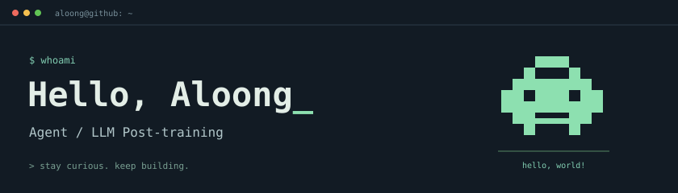

  

# <samp>&gt; hello, world.</samp> 👾

- 🎓 **天津大学** · 硕士在读
- 🔬 研究兴趣：**Agent系统**与**大模型后训练**
- 📍 杭州 · Hangzhou

## Projects & learning

| Repository | About |
| --- | --- |
| [deep-research-agent](https://github.com/Coding-Lml/deep-research-agent) 研究工作流实践 | 研究型 Agent 工作流：多视角规划、并行研究与证据审核。 |
| [mini-claude](https://github.com/Coding-Lml/mini-claude) Coding Agent 学习实践 | 基于[开源教程](https://github.com/Windy3f3f3f3f/claude-code-from-scratch)的终端 Coding Agent 学习实践，涉及工具调用与会话管理。 |
| [agent-basic-html](https://github.com/Coding-Lml/agent-basic-html) 知识整理 | Agent 学习知识库：从基础概念到工具、记忆与多 Agent 编排。 |

---

<samp>// stay curious. keep building.</samp>

